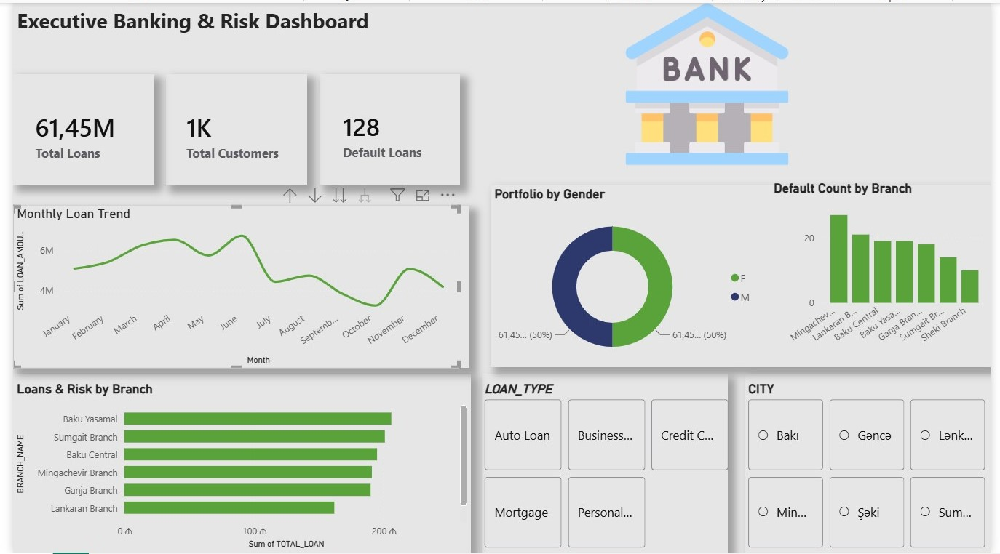

# Bank Kredit Portfeli və Müştəri Risk Analitikası

Real analitik iş prosesini əks etdirən, üç alətin bir zəncirdə birləşdiyi hərtərəfli layihə: data modelləşdirmə və analiz üçün **Oracle SQL**, hesabat üçün **Excel**, interaktiv dashboard üçün isə **Power BI**.

> **Data haqqında qeyd:** bu data sintetikdir (PL/SQL skripti ilə `DBMS_RANDOM` istifadə edilərək yaradılıb) və real bank kredit portfelini simulyasiya edir. Real müştəri datası deyil — burada məqsəd analitik iş prosesini və alət bacarıqlarını nümayiş etdirməkdir, real bir bankın portfelini modelləşdirmək deyil.

## Layihə haqqında

Regional bir bank öz kredit portfelini anlamaq istəyir: portfel filiallar üzrə necə paylanıb, hansı müştərilər daha çox risk daşıyır və zaman keçdikcə kredit verilişi/default halları necə dəyişib.

**Dataset:** 7 filial, 1,000 müştəri, 1,300 kredit, ~6,000 əməliyyat (2020–2025).

## Alətlər və hər birinin əhatə etdiyi iş

| Alət | Nə edilib |
|---|---|
| **Oracle SQL** | Sxem dizaynı, sintetik data generasiyası, çox cədvəlli JOIN-lər, window function-lu CTE, təkrar istifadə olunan VIEW, parametrli PL/SQL stored procedure |
| **Excel** | Xam datanın yerləşdirilməsi, `XLOOKUP` ilə zənginləşdirilmiş analiz cədvəli, KPI icmalı, PivotTable-lar və aylıq trend qrafiki |
| **Power BI** | Oracle-a birbaşa qoşulan, KPI kartları, filial/seqment slicer-ləri və aylıq trend xətti olan bir səhifəlik interaktiv dashboard | 

## Repo strukturu

```
bank-loan-portfolio-analytics/
├── sql/
│   ├── 01_schema_and_data.sql      # cədvəl strukturu + sintetik data generasiyası
│   ├── 02_analysis_queries.sql     # JOIN/GROUP BY, window function-lu CTE, aylıq trend
│   └── 03_view_and_procedure.sql   # vw_branch_risk_summary VIEW-u + get_customer_risk_profile procedure-u
├── excel/
│   └── bank_loan_analysis.xlsx     # xam data, XLOOKUP analizi, PivotTable-lar, trend qrafiki
├── powerbi/
│   └── bank_loan_dashboard.pbix    # interaktiv dashboard (Power BI Desktop)
└── screenshots/
    └── dashboard_overview.png      # dashboard-un önizləməsi (Power BI olmayanlar üçün)
```

## SQL-in önə çıxan məqamları

- **Sxem və sintetik data** — bir-birinə bağlı 4 cədvəl, statik nümunə sətirlər əvəzinə real və müxtəlif qeydlər (fərqli filiallar, kredit növləri, statuslar, gecikmə ssenariləri) yaradan PL/SQL döngəsi ilə doldurulub.
- **CTE + window function** — hər filialın TOP 3 borclu müştərisini bir sorğuda tapmaq üçün `DENSE_RANK() OVER (PARTITION BY ...)`.
- **VIEW** — `vw_branch_risk_summary` default faizi hesablama məntiqini bir yerdə mərkəzləşdirir ki, Excel və Power BI eyni məntiqi təkrarlamaq əvəzinə eyni mənbədən oxusun.
- **Stored procedure** — `get_customer_risk_profile(p_customer_id)` istənilən müştəri üçün sürətli risk icmalı qaytarır (kredit sayı, ümumi borc, ən pis gecikmə, risk işarəsi).

## Əsas tapıntılar

- Filiallar üzrə default faizi **6.4%-dən 14.1%-ə** qədər dəyişir — Mingəçevir və Lənkəran filialları, bənzər portfel həcminə (7–9.8 milyon AZN) baxmayaraq, Şəki və ya Sumqayıtdan əhəmiyyətli dərəcədə yüksəkdir, bu da kredit təsdiq prosesinin filial səviyyəsində nəzərdən keçirilməsinin faydalı ola biləcəyini göstərir.
- Aylıq kredit verilişi nisbətən sabit qalır (ayda 10-30 kredit), amma default sayı hamar trend əvəzinə konkret aylarda (məs. 2022-nin sonu, 2023-ün ortası) kəskin artır — bu dövrlərin ayrıca araşdırılması faydalı olardı.

## Data təmizləmə qeydləri

Datanı alətlər arasında daşıyarkən real problemlərlə qarşılaşıldı və həll edildi:
- Mətn kimi export olunan tarixlər, aya görə qruplaşdırılmadan əvvəl `DATEVALUE` / Power Query tip çevrilməsi tələb etdi.
- Mənbə datasındakı `.` onluq ayırıcısı ilə cədvəlin `,` onluq parametri arasındakı uyğunsuzluq `SUM()` funksiyasının kəsirli ədədlər üçün səssizcə 0 qaytarmasına səbəb oldu — `NUMBERVALUE()` ilə düzəldildi.

## Müəllif

Kenan Qurayishov — [LinkedIn](www.linkedin.com/in/kənan-qurayışov) · [GitHub](https://github.com/kenan-dataanalyst)
